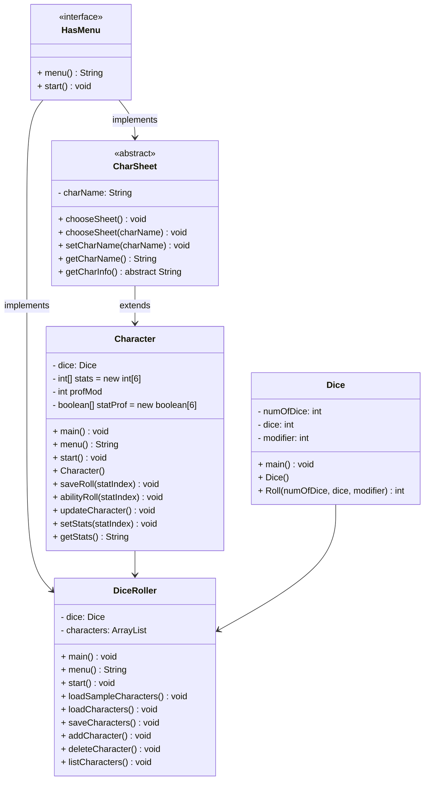

# DnDDiceRoller

## UML

## HasMenu
```
interface HasMenu
...................
    String menu()
    void start()
...................
```
## Dice
```
class Dice
....................
int numOfDice, dice, modifier
....................
void main()
Dice()
int Roll(numOfDice, dice, modifier)
```
## CharSheet
```
abstract class CharSheet implements HasMenu, Serializable
....................
String charName
....................
chooseSheet()
chooseSheet(charName)
void setCharName(charName)
String getCharName()
abstract String getCharInfo()
....................
```
## Character
```
....................
Dice dice
int[] stats = new int[6]
int profMod
boolean[] statProf = new boolean[6]
....................
void main()
Character()
String menu()
void start()
void saveRoll(statIndex)
void abilityRoll(statIndex)
void updateCharacter()
String getStats()
void setStats(statIndex)
```
## DiceRoller
```
....................
Dice dice
ArrayList characters
....................
void main()
String menu()
void start()
void loadSampleCharacters()
void loadCharacters()
void saveCharacters()
void addCharacter()
void deleteCharacter()
void listCharacters()
```
